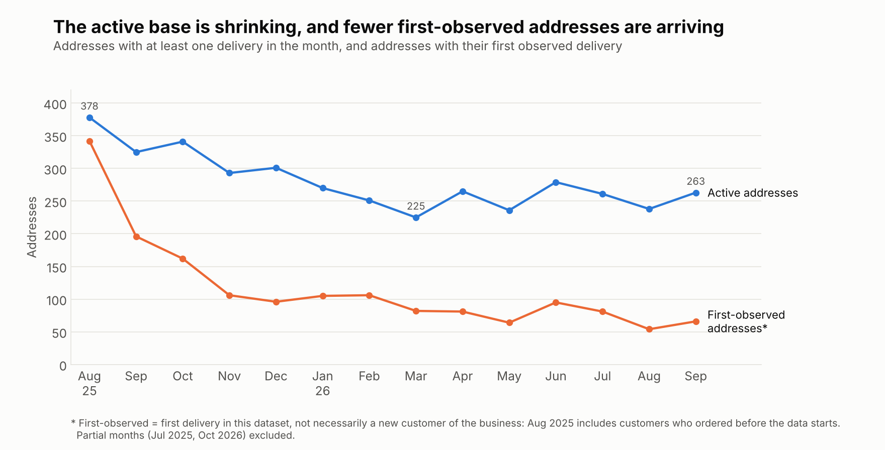
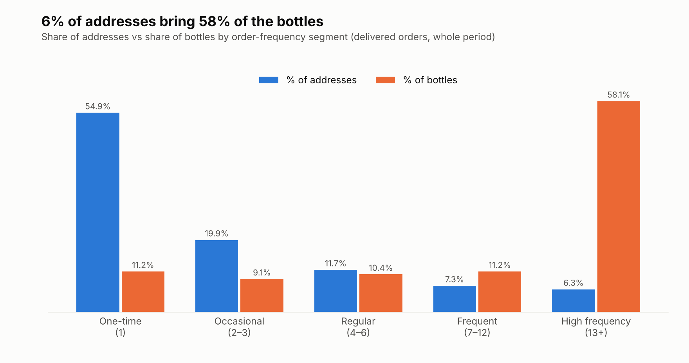

# Water Delivery Business: Sales, Customer and Operations Analysis

SQL analysis of 7,245 order records from a bottled-water delivery business in Astana, Kazakhstan (29 Jul 2025 – 29 Oct 2026). The project turns raw CRM orders into findings about sales dynamics, customer behavior, and delivery workload, with practical recommendations.

**Full report: [business_insights.md](business_insights.md)**

## Key Findings

- **Volume is declining, mostly through fewer active addresses.** Comparing August–October 2026 with the same months of 2025: delivered orders −18.7%, bottles −36.9%, addresses with a delivery −44.9%.
- **Volume depends on a small group of addresses.** The top 10% of addresses generate 65.1% of bottles; two addresses alone account for 21.9%.
- **Most addresses order once.** 54.9% of addresses have a single delivered order, but those who stay reorder fast (median gap 12 days).
- **A valuable group has gone quiet.** 89 addresses with 7+ deliveries have not ordered for 60+ days and account for 23.9% of all bottles.
- **Workload is uneven.** Monday averages 24.6 orders per day versus 18–19 on Wednesday–Friday.
- **Request statuses look unreliable in 2026.** 297 of 316 "active requests" are more than 30 days old.





## Business Questions

1. How does sales volume change over time?
2. What patterns can be identified in customer ordering behavior?
3. How concentrated are orders and volume among the most active customers?
4. What is the typical order size, and how does it vary?
5. How does operational workload vary across days?
6. What practical improvements could be considered?

## Repository Structure

```
├── business_insights.md        # full business report with findings and recommendations
├── sql/
│   ├── 01_data_quality.sql     # structure, date range, statuses, missing values, duplicates
│   ├── 02_sales_analysis.sql   # monthly volume, MoM change, order size, weekday patterns
│   ├── 03_customer_analysis.sql# segmentation, activity status, repeat intervals, cohorts
│   └── 04_operational_analysis.sql # daily workload, peak days
├── charts/                     # PNG charts used in the report + make_charts.py
└── data/
    └── orders_anonymized.csv   # anonymized order data (7,245 rows)
```

## Tools

- SQL (DuckDB, Duck-UI) for the analysis
- Python (pandas, matplotlib) for the charts and for a few supplementary calculations

## How to Reproduce

1. Load the data into DuckDB:

   ```sql
   CREATE TABLE orders_anonymized AS
   SELECT * FROM read_csv_auto('data/orders_anonymized.csv');
   ```

2. Run the files in `sql/` in order (01 → 04).
3. Rebuild the charts:

   ```bash
   pip install pandas matplotlib openpyxl
   python charts/make_charts.py data/orders_anonymized.csv charts
   ```

Note: the concentration analysis, the August–October period comparison, and the lapsed-customer list in the report were calculated in Python, not in the SQL files.

## Data Notes

- `address_id` is an anonymized **address**, not a verified person. The report speaks about addresses and repeat activity, not exact customer counts.
- The data has a gap between 22 Feb and 6 Mar 2026; July 2025 and October 2026 are partial months.
- Price and payment fields are incomplete, so revenue is not part of the conclusions.
- The analysis is descriptive. Causes mentioned in the report are hypotheses, not established effects.

See section 8 of the report for the full list of limitations.
