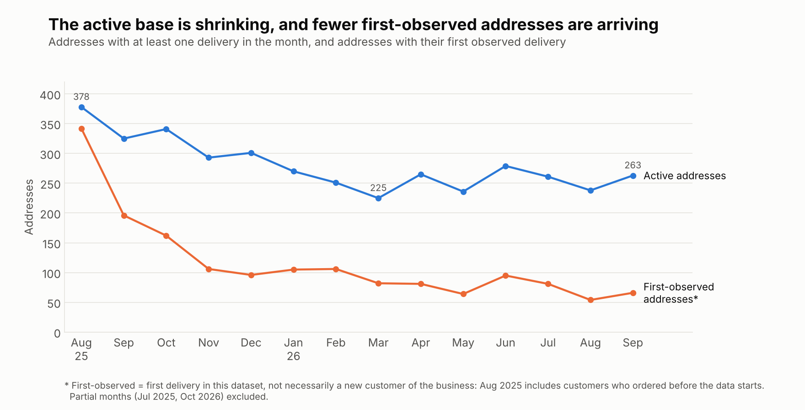
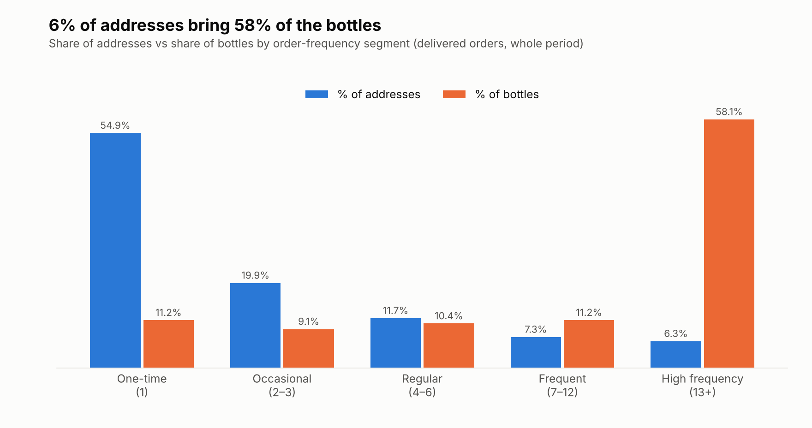

# Анализ бизнеса по доставке воды: продажи, клиенты и операционная деятельность

SQL-анализ 7 245 заказов компании по доставке бутилированной воды в Астане, Казахстан (29 июля 2025 — 29 октября 2026 года). Цель проекта — преобразовать данные CRM в выводы о динамике продаж, поведении клиентов и нагрузке на доставку, а также сформулировать практические рекомендации для бизнеса.

**Полный бизнес-отчёт:** [business_insights.md](business_insights.md)

**Языки:** [Русский](README.ru.md) | [English](README.md)

## Ключевые результаты

- **Объём бизнеса сокращается, в основном из-за уменьшения числа активных адресов.** При сравнении августа–октября 2026 года с аналогичным периодом 2025 года: количество доставленных заказов снизилось на 18,7%, количество бутылей — на 36,9%, число адресов с доставками — на 44,9%.
- **Значительная часть объёма приходится на небольшую группу адресов.** На 10% наиболее активных адресов приходится 65,1% всех бутылей; только два адреса обеспечивают 21,9%.
- **Большинство адресов оформляют только один заказ.** У 54,9% адресов зафиксирован один доставленный заказ. При этом адреса, которые продолжают пользоваться услугой, обычно делают повторный заказ достаточно быстро: медианный интервал составляет 12 дней.
- **Выявлена значимая группа адресов, которые давно не заказывали.** 89 адресов, на каждом из которых было не менее 7 доставок, не оформляли заказы более 60 дней. На них приходится 23,9% общего объёма бутылей.
- **Нагрузка распределена по дням недели неравномерно.** В среднем по понедельникам приходится 24,6 заказа в день, тогда как по средам–пятницам — 18–19.
- **Статусы заявок в 2026 году могут быть неактуальными.** Из 316 заявок со статусом «Актуальные заявки» 297 созданы более 30 дней назад.





## Бизнес-вопросы

1. Как меняется объём продаж с течением времени?
2. Какие закономерности можно выявить в поведении клиентов?
3. Насколько сконцентрированы заказы и объём доставок среди наиболее активных адресов?
4. Каков типичный размер заказа и как он меняется?
5. Как распределяется операционная нагрузка по дням недели?
6. Какие практические улучшения можно предложить бизнесу?

## Структура репозитория

```text
water-delivery-analysis/
├── README.md
├── README.ru.md
├── business_insights.md
├── data/
│   └── orders_anonymized.csv
├── sql/
│   ├── 01_data_quality.sql
│   ├── 02_sales_analysis.sql
│   ├── 03_customer_analysis.sql
│   └── 04_operational_analysis.sql
└── charts/
    ├── 01_monthly_bottles_orders.png
    ├── 02_active_and_first_observed_addresses.png
    ├── 03_customer_segments.png
    ├── 04_concentration_curve.png
    ├── 05_cohort_retention.png
    ├── 06_workload_by_weekday.png
    ├── 07_repeat_order_intervals.png
    └── make_charts.py
```

## Инструменты

- **SQL (DuckDB, Duck-UI)** — анализ данных и расчёт показателей.
- **Python (pandas, matplotlib)** — построение графиков и дополнительные расчёты. Все графики создаются скриптом `charts/make_charts.py` на основе `data/orders_anonymized.csv`.

## Как воспроизвести анализ

1. Загрузить данные в DuckDB:

   ```sql
   CREATE TABLE orders_anonymized AS
   SELECT * FROM read_csv_auto('data/orders_anonymized.csv');
   ```

2. Выполнить SQL-файлы из папки `sql/` по порядку (01 → 04).
3. Построить графики заново:

   ```bash
   pip install pandas matplotlib openpyxl
   python charts/make_charts.py data/orders_anonymized.csv charts
   ```

**Примечание:** анализ концентрации, сравнение периодов август–октябрь и список адресов без заказов более 60 дней были рассчитаны в Python, а не в SQL-файлах.

## Примечания и ограничения данных

- `address_id` — это обезличенный идентификатор адреса, а не подтверждённый идентификатор человека. Поэтому в отчёте анализируется активность адресов, а не точное количество клиентов.
- В данных отсутствуют записи за период с 22 февраля по 6 марта 2026 года. Июль 2025 года и октябрь 2026 года представлены не полностью.
- Данные о ценах и способах оплаты заполнены не полностью (сумма заказа равна нулю у 100% доставленных заказов начиная с мая 2026 года), поэтому выручка не используется в качестве основы выводов.
- Анализ носит описательный характер. Указанные в отчёте возможные причины наблюдаемых изменений являются гипотезами, а не доказанными причинно-следственными связями.

Полный список ограничений приведён в разделе 8 бизнес-отчёта.

## Использование ИИ

Проект выполнен с использованием инструментов искусственного интеллекта. Claude (Anthropic) использовался для написания Python-скрипта построения графиков и дополнительных расчётов, а также для помощи в подготовке и редактировании отчёта и README. Я не пишу код на Python самостоятельно: Python-код написан ИИ-ассистентом, а я использовал его как инструмент для построения графиков и проверок. Данные, бизнес-контекст и ответственность за итоговое содержание принадлежат мне.

## Автор

Nurmagambet Akimbekov

Email: venturauly@gmail.com

Telegram: @venturauly
