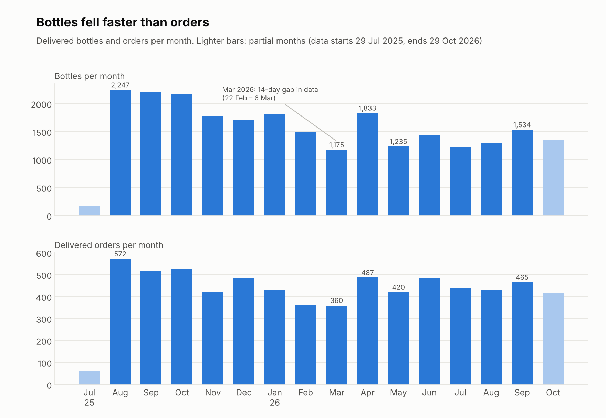
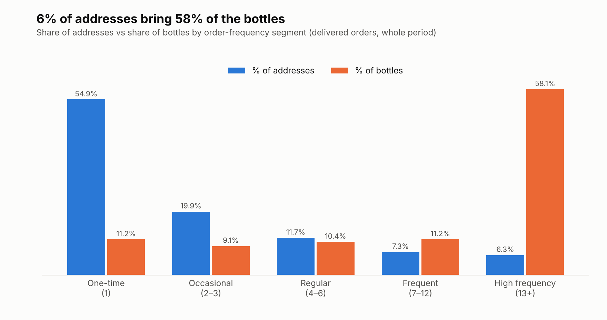
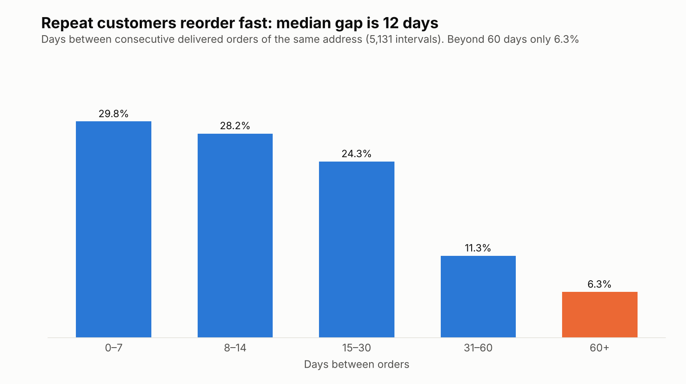
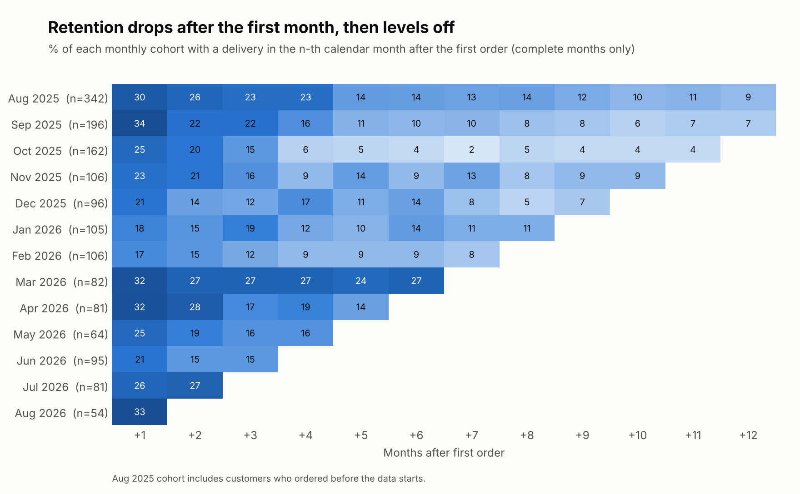
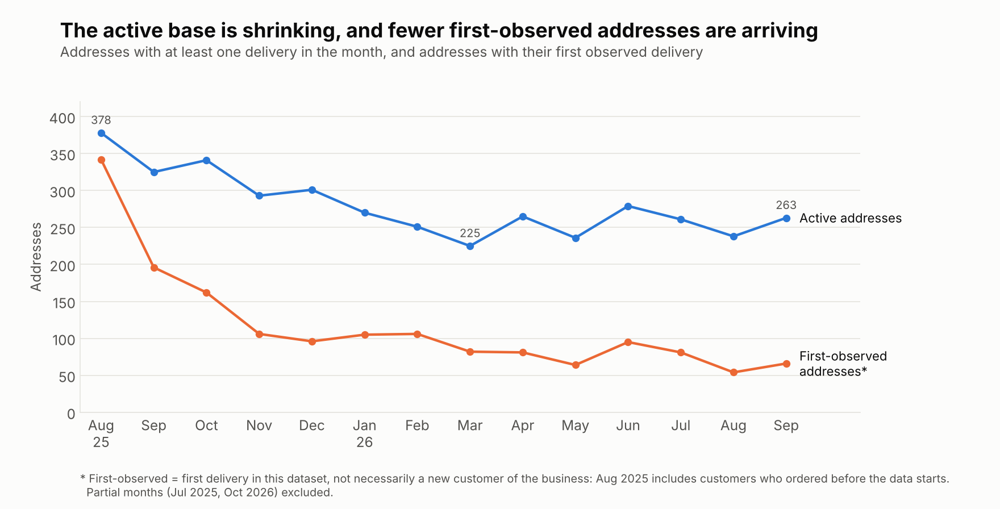
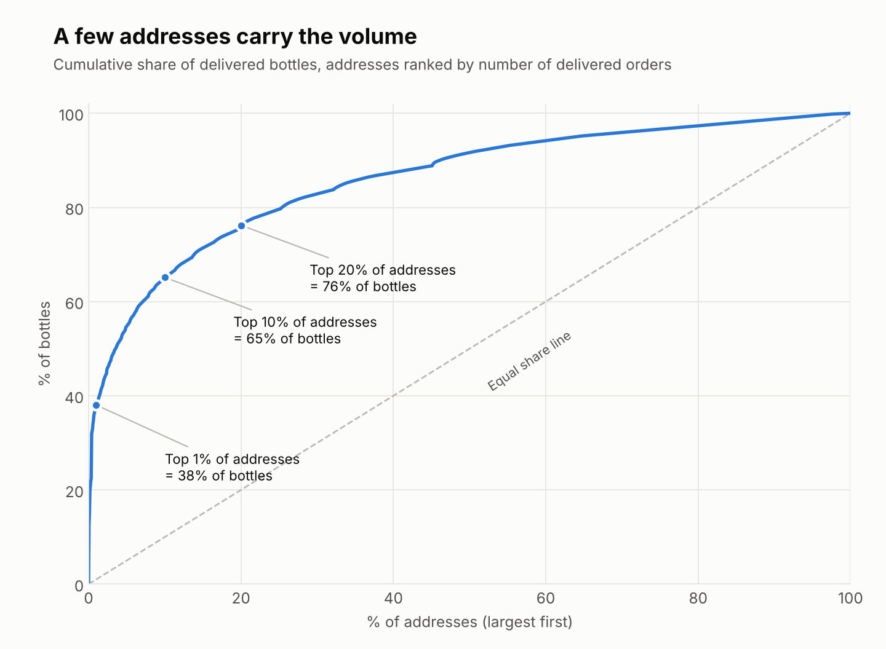
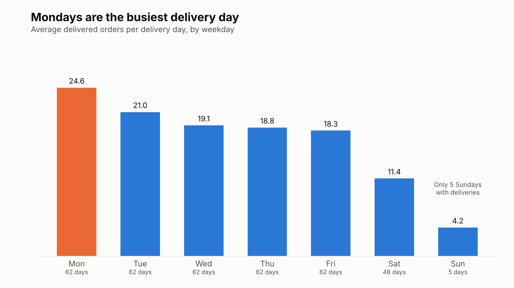

# Business Analysis: Water Delivery Business

## 1. Project Overview

This project analyzes order data from a water delivery business operating in Astana, Kazakhstan.

The goal is to use SQL to examine sales performance, customer behavior, and operational activity, then translate the findings into practical business insights and recommendations.

The project is based on anonymized operational data from the business.

### Key Findings at a Glance

1. **Volume is declining, mostly through fewer active addresses.** Comparing the same three months a year apart (August–October), delivered orders fell 18.7% (1,616 → 1,314), bottles fell 36.9% (6,630 → 4,183), and the number of distinct addresses ordering fell 44.9% (745 → 410).
2. **Volume depends on a small group of addresses.** The top 10% of addresses (by order count) generate 53.3% of delivered orders and 65.1% of bottles. Two addresses alone account for 21.9% of all bottles.
3. **Most addresses order once.** 54.9% of addresses have a single delivered order. Among addresses with at least 60 days of observation, 28.3% reordered within 30 days and 37.4% within 60 days.
4. **Repeat ordering is regular for those who stay.** The median gap between repeat orders is 12 days, and 93.7% of gaps are 60 days or shorter. Silence of more than 60 days is therefore unusual.
5. **A valuable group has gone quiet.** 89 addresses with 7+ deliveries have not ordered for more than 60 days. They account for 23.9% of all delivered bottles in the dataset.
6. **Workload is uneven across the week.** Monday averages 24.6 delivered orders per day versus 18–19 on Wednesday–Friday. About 6% of delivery days exceed 30 orders.
7. **Request statuses look unreliable in 2026.** 297 of 316 "active requests" are more than 30 days old at the end of the data, and cancellations are almost absent after March 2026.

## 2. Business Questions

The analysis focuses on the following questions:

1. How does sales volume change over time?
2. What patterns can be identified in customer ordering behavior?
3. How concentrated are orders and sales volume among the most active customers?
4. What is the typical order size, and how does it vary?
5. How does operational workload vary across days?
6. What practical improvements could be considered based on the findings?

## 3. Data and Methodology

### Dataset

The analysis uses `orders_anonymized.csv`.

- Number of records: 7,245
- Number of unique addresses: 1,806 (1,750 of them have at least one delivered order)
- Date range: 2025-07-29 – 2026-10-29
- One row represents one order or delivery record.
- Customer addresses are anonymized and represented by `address_id`.

The `Date` column is stored in `YYYY-MM-DD` format. All 7,245 date values were converted successfully.

### Customer Identification

`address_id` is the only available identifier for tracking customers in this dataset.

It is used as the primary customer identifier throughout the analysis. This allows us to examine repeat orders, purchase frequency, customer activity, and retention.

`address_id` is an anonymized address, not a verified person. One person may order from several addresses, and one address may serve several people (for example an office or a residential building). For this reason the report speaks about **addresses** and **repeat activity**, not about an exact number of unique people.

### Tools

- SQL
- DuckDB
- Duck-UI

### Analysis Areas

The SQL analysis is organized into four files in the `sql/` folder:

- `01_data_quality.sql` — data quality checks.
- `02_sales_analysis.sql` — sales and order analysis.
- `03_customer_analysis.sql` — customer behavior and repeat orders.
- `04_operational_analysis.sql` — operational activity and delivery workload.

### Methodology

The analysis uses SQL queries to aggregate, compare, and examine order data.

The main analytical methods include:

- Monthly and month-over-month comparisons.
- Order size and sales volume analysis.
- Customer segmentation by order frequency.
- Customer activity and repeat purchase analysis.
- Cohort retention analysis.
- Operational workload analysis.

Unless stated otherwise, all results use delivered orders (`Status = 'Доставлено'`). The analysis is descriptive. Observed relationships and patterns should not automatically be interpreted as causal effects.

## 4. Sales Analysis

### 4.1 Sales Dynamics

The dataset contains 6,881 delivered orders and 24,679 bottles across the analyzed period.

The highest monthly order volume was recorded in August 2025, with 572 delivered orders and 2,247 bottles.

A notable increase occurred in April 2026 compared with March:
- Delivered orders increased by 35.3%.
- Bottle volume increased by 56.0%.
- Average order size increased from 3.26 to 3.76 bottles.

In May 2026, sales volume declined:
- Delivered orders decreased by 13.8%.
- Bottle volume decreased by 32.6%.
- Average order size fell from 3.76 to 2.94 bottles.

In September 2026, the business recorded another increase:
- Delivered orders increased by 7.6%.
- Bottle volume increased by 18.3%.
- Average order size rose from 3.00 to 3.30 bottles.

The average order size declined from 3.93 bottles in August 2025 to 3.30 bottles in September 2026.

These changes indicate fluctuations in both order frequency and order size. Section 5 shows that much of this movement is linked to who is ordering: a small group of large-volume addresses and a shrinking number of active addresses.

Note: July 2025 is a partial month because the dataset starts on July 29. October 2026 is also incomplete, with data available only through October 29.

### 4.2 Month-over-Month Changes

Month-over-month analysis shows considerable fluctuations in monthly bottle volume.

The most notable changes include:

- August 2025: an increase of 2,077 bottles compared with July 2025. This comparison is distorted because July is a partial month.
- November 2025: a decrease of 18.28% compared with October.
- February 2026: a decrease of 17.26% compared with January.
- March 2026: a further decrease of 21.67% compared with February.
- April 2026: a strong increase of 56.00% compared with March.
- May 2026: a decrease of 32.62% compared with April.
- June 2026: an increase of 16.03% compared with May.
- September 2026: an increase of 18.27% compared with August.
- October 2026: a decrease of 11.86% compared with September.

The results indicate substantial month-to-month fluctuations in sales volume rather than a consistent growth trend.

The decline recorded in March 2026 should be interpreted cautiously because the dataset has a gap between February 22 and March 6, 2026.

July 2025 is a partial month, and October 2026 is incomplete, with data available only through October 29.

These fluctuations suggest that both order frequency and average order size should be considered when evaluating business performance.

**Same-period comparison (August–October, 2025 vs 2026).** Because the two periods are one year apart, seasonality is partly controlled.

| Metric | Aug–Oct 2025 | Aug–Oct 2026 | Change |
|---|---:|---:|---:|
| Delivered orders | 1,616 | 1,314 | −18.7% |
| Bottles | 6,630 | 4,183 | −36.9% |
| Distinct addresses with a delivery | 745 | 410 | −44.9% |

Bottles fell about twice as fast as orders, so the average order became smaller, and the number of addresses fell faster still. The sections below look at why.

### 4.3 Order Size Summary

The average order size was 3.59 bottles, while the median order size was 2 bottles.

The difference between the average and median indicates a right-skewed distribution: larger orders increase the average above the value of a typical order.

Order size ranged from 1 to 110 bottles. The maximum value suggests that some orders may be substantially larger than typical deliveries.

This means that the average alone does not fully represent typical customer ordering behavior. Both the mean and median should be considered when evaluating order size. Section 4.5 shows how often large orders occur and how much they contribute to total volume.

### 4.4 Demand Patterns by Day of the Week

The weekday analysis shows that most delivered orders occurred on weekdays.

Monday recorded the highest number of delivered orders (1,525) and the highest bottle volume (5,438).

From Monday to Friday, the business handled 6,315 delivered orders, representing approximately 91.8% of all delivered orders.

Saturday accounted for 545 orders, while Sunday had only 21 orders.

The average order size on weekdays was relatively stable, ranging from 3.47 to 3.70 bottles.

Sunday had the highest average order size at 9.24 bottles. However, this figure is based on only 21 orders and should be interpreted cautiously.

The results suggest that weekday demand is driven primarily by a higher number of orders rather than substantial differences in average order size.

Average daily workload by weekday is analyzed in section 6.2.

### 4.5 Order Size Distribution

- 60.17% of delivered orders contain exactly 2 bottles. The typical order is small and predictable.
- Orders of 6 or more bottles make up 9.49% of delivered orders but 37.89% of all bottles.
- 653 orders of 6+ bottles came from only 116 addresses, so large orders are a feature of a limited group of addresses rather than a general pattern.
- The share of 6+ bottle orders fell from 12–15% of monthly orders in August–October 2025 to 4–6% in May–August 2026 (3.8% in May 2026). This is the main reason the average order size declined, since the median stayed at 2 bottles in every month.

Takeaway: total bottle volume is sensitive to a small number of large orders, while order count reflects the broad base of 2-bottle customers. The two metrics should be monitored separately.

## 5. Customer Analysis

All customer results use `address_id` as the customer proxy (see section 3).

### 5.1 Customer Segmentation

Segments are based on the number of delivered orders per address over the whole period.

| Segment | Delivered orders per address | Addresses | % of addresses | % of delivered orders | % of bottles |
|---|---|---:|---:|---:|---:|
| One-time | 1 | 961 | 54.91% | 13.97% | 11.18% |
| Occasional | 2–3 | 348 | 19.89% | 11.89% | 9.11% |
| Regular | 4–6 | 204 | 11.66% | 14.17% | 10.41% |
| Frequent | 7–12 | 127 | 7.26% | 16.15% | 11.20% |
| High frequency | 13+ | 110 | 6.29% | 43.83% | 58.11% |
| **Total** | | **1,750** | 100% | 100% | 100% |

- The typical address is a one-time address: the median is 1 delivered order per address, while the mean is 3.93 (highest: 134).
- The 110 high-frequency addresses (6.3% of the base) generate 43.8% of orders and 58.1% of bottles.
- One-time addresses are more than half of the base but only 11.2% of bottles.

Note: the one-time group includes addresses whose first order is recent, so some of them may still reorder. Among addresses with at least 60 days of history (first order on or before 2026-08-30), 53.3% still have only one delivered order, so the pattern is not just a recency effect.

### 5.2 Customer Activity

Status is based on days since the last delivered order, measured at the end of the data (2026-10-29).

| Status | Addresses | % of addresses | Delivered orders (all time) | Bottles (all time) |
|---|---:|---:|---:|---:|
| Active: 0–30 days | 266 | 15.2% | 3,056 | 11,561 |
| At risk: 31–60 days | 91 | 5.2% | 392 | 1,016 |
| Inactive: 60+ days | 1,393 | 79.6% | 3,433 | 12,102 |

- "Inactive" means no delivery for more than 60 days. It does not prove that the customer is lost, and the threshold is a working assumption. It is supported by the repeat-order intervals in 5.3, where only 6.3% of gaps exceed 60 days.
- 870 of the 1,393 inactive addresses are one-time addresses.
- More important for the business are the lapsed repeat customers: **241 addresses with 4+ deliveries and 89 addresses with 7+ deliveries are inactive.** The 89 addresses account for 5,888 bottles, or 23.9% of all delivered bottles in the dataset; 25 of them (13+ deliveries) account for 4,598 bottles, or 18.6%.
- 31 more addresses with 4+ deliveries are currently in the at-risk window (31–60 days).

### 5.3 Repeat Purchase Behavior

Based on 5,131 intervals between consecutive delivered orders of the same address.

| Interval | Repeat intervals | Share |
|---|---:|---:|
| 0–7 days | 1,531 | 29.84% |
| 8–14 days | 1,446 | 28.18% |
| 15–30 days | 1,248 | 24.32% |
| 31–60 days | 581 | 11.32% |
| 60+ days | 325 | 6.33% |

- The median interval is 12 days (mean 21.3). 58.0% of intervals are 14 days or shorter, and 82.3% are 30 days or shorter.
- Addresses that continue to order do so frequently. This supports using 30 and 60 days as early-warning thresholds.
- Among addresses with at least 60 days of history, 28.3% placed a second order within 30 days of the first, 37.4% within 60 days, and 46.7% at any time. **The first reorder is the largest drop-off point in the customer journey.**

### 5.4 Customer Retention

Cohort = month of the first delivered order observed in the data. An address is counted as active in a month if it had at least one delivery in that calendar month.

Weighted retention across cohorts from August 2025 to August 2026 (only cohorts with enough observed months, complete months through September 2026):

| Months after first order | Retention |
|---|---:|
| Month +1 | 26.4% |
| Month +2 | 21.4% |
| Month +3 | 18.7% |
| Month +6 | 12.1% |

Selected cohorts:

| Cohort | Addresses | M+1 | M+3 | M+6 |
|---|---:|---:|---:|---:|
| Aug 2025 | 342 | 29.5% | 23.4% | 14.0% |
| Sep 2025 | 196 | 33.7% | 21.9% | 9.7% |
| Oct 2025 | 162 | 24.7% | 14.8% | 4.3% |
| Dec 2025 | 96 | 20.8% | 12.5% | 13.5% |
| Feb 2026 | 106 | 17.0% | 12.3% | 9.4% |
| Mar 2026 | 82 | 31.7% | 26.8% | 26.8% |
| Jun 2026 | 95 | 21.1% | 14.7% | — |

- Retention falls fastest in the first month and then levels off at roughly 10–15%. The customers who remain after month 3 tend to stay.
- Cohort-level results vary (M+1 from 17.0% to 33.7%), and small cohorts of 50–100 addresses are noisy. Differences between individual cohorts should not be over-interpreted.
- The number of first-observed addresses (addresses with their first delivery in the dataset) per month has dropped: 196 in September 2025, 162 in October 2025, and 50–95 per month in 2026 (50 in October 2026, through the 29th). Together with low retention, this explains the shrinking active base (378 active addresses in August 2025, 238–263 in August–October 2026).

Important: the August 2025 cohort (342 addresses) includes customers who were already ordering before the data starts, so their true first order was earlier. July 2025 (64 addresses, 3 days) is a partial cohort and is excluded from the weighted figures. For this reason cohorts are described as "first-observed", not as new customers, and the first cohorts overstate genuinely new customers.

### 5.5 Customer Concentration

Addresses ranked by number of delivered orders:

| Top addresses | Share of delivered orders | Share of bottles |
|---|---:|---:|
| Top 1% (18 addresses) | 16.6% | 38.0% |
| Top 5% (88) | 39.4% | 54.9% |
| Top 10% (175) | 53.3% | 65.1% |
| Top 20% (350) | 68.9% | 75.6% |

Ranked by bottle volume, the top 2 addresses account for 21.9% of all bottles, the top 5 for 30.3%, and the top 10 for 35.1%.

- The largest address (`ADDR_1322`) alone accounts for 3,069 bottles (12.4% of all bottles) from 134 orders, about 23 bottles per order. **Its last delivery was on 2026-04-29.** Its 314 bottles in April account for about half (52%) of the 598-bottle drop between April and May 2026. Excluding this address, May bottle volume still fell by 18.7% versus April, so it explains only part of the decline.
- The second largest (`ADDR_1339`, 2,333 bottles) is still active, but its monthly volume has fallen from roughly 200–300 bottles in most months of 2025 (111 in December) to 50–140 between May and October 2026.
- Such patterns (large volumes, regular deliveries) may indicate business or institutional customers, but the data does not confirm this.

Business implication: results are exposed to the behavior of a few addresses. A change at one or two of them can move monthly volume more than any campaign aimed at the broad base.

## 6. Operational Analysis

### 6.1 Order Status Distribution

| Status | Records | Share |
|---|---:|---:|
| Delivered | 6,881 | 94.98% |
| Active requests (`Актуальные Заявки`) | 316 | 4.36% |
| Cancelled | 48 | 0.66% |

- The recorded cancellation rate is low (0.66%), but the status data raises questions:
  - 297 of the 316 active requests are more than 30 days old at the end of the data. Open requests grew from 0–17 per month until February 2026 to 28–53 per month between March and August 2026. Requests that old are unlikely to be genuinely pending.
  - Recorded cancellations drop to almost zero from April 2026 (2 records between April and October versus 9–10 per month in August–November 2025).
- One possible explanation is that cancelled or unfulfilled requests were left open instead of being closed with the correct status. This is a hypothesis to check with the business. If it is correct, up to 5.0% of requests did not end in a delivery (364 of 7,245), not 0.66%.

### 6.2 Daily Workload

Based on 363 days with at least one delivery.

| Metric | Orders per day | Bottles per day |
|---|---:|---:|
| Average | 18.96 | 67.99 |
| Median | 19 | 63 |
| Maximum | 43 | 195 |

Average workload by weekday:

| Weekday | Days | Avg. orders per day | Avg. bottles per day |
|---|---:|---:|---:|
| Monday | 62 | 24.6 | 87.7 |
| Tuesday | 62 | 21.0 | 73.1 |
| Wednesday | 62 | 19.1 | 70.5 |
| Thursday | 62 | 18.8 | 68.3 |
| Friday | 62 | 18.3 | 67.8 |
| Saturday | 48 | 11.4 | 35.6 |
| Sunday | 5 | 4.2 | 38.8 |

- Monday carries about 30% more orders per day than Wednesday–Friday and the highest bottle volume per day. The workload falls steadily from Monday to Friday.
- Saturday is a half-load day and Sunday is rarely worked (5 days), so Sunday is not meaningful for planning.
- Delivery days with 30 or more orders: 22 of 363 (about 6%). The 90th percentile is 28 orders per day and the 95th is 30.

### 6.3 Peak Workload

- The busiest day was 2025-10-20 (43 orders, 158 bottles). The day with the most bottles was 2025-11-03 (38 orders, 195 bottles), driven by large orders.
- Among the 15 busiest days by order count, 9 are Mondays and 10 fall in August–December 2025, which matches the higher overall volume in that period.
- Days with 30+ orders: 18 before April 2026 and only 4 from April 2026 onward (maximum 33), so peaks are lower than in autumn 2025.

Note: the dataset has no timestamps, courier counts, or delivery times, so capacity, delivery speed, and courier productivity cannot be measured. Workload is measured only in orders and bottles per day.

## 7. Business Recommendations

Recommendations are based on descriptive findings. Each one should be tested on a small scale before wider use.

| # | Recommendation | Evidence | Metric to track |
|---|---|---|---|
| 1 | **Contact lapsed repeat customers.** Prepare a list of addresses with 4+ deliveries (241) and 7+ deliveries (89) that have been inactive for more than 60 days, starting with the 25 addresses with 13+ deliveries. Call or message them to find the reason and offer to resume deliveries. | The 89 addresses with 7+ deliveries represent 23.9% of all bottles in the data. | Share of contacted addresses that reorder within 30 days |
| 2 | **Set up an early-warning rule for regular addresses.** Flag any address with 4+ deliveries that has not ordered for 30 days (31 addresses are in this state now). | Median interval between orders is 12 days; 93.7% of intervals are within 60 days. | Number of flagged addresses; reorder rate after contact |
| 3 | **Manage the largest addresses individually.** Assign an owner to the top 10–20 addresses, track their monthly volume, and find out why `ADDR_1322` stopped ordering after April 2026. Consider standing orders or contracts for large customers. | Top 10 addresses = 35.1% of bottles; top 2 = 21.9%. | Monthly bottles from the top 20 addresses |
| 4 | **Improve conversion from first to second order.** Follow up with a new address within 1–2 weeks of the first delivery (reminder, standing delivery option, small incentive). | 53.3% of addresses with 60+ days of history ordered once; 28.3% reorder within 30 days; typical repeat gap is 12 days. | Share of first-observed addresses with a second order within 30 days (baseline 28.3%) |
| 5 | **Restore new-address acquisition.** Set a monthly target for newly acquired addresses and track the source of each new order. | First-observed addresses fell from 196 (Sep 2025) to 50–95 per month in 2026. | First-observed addresses per month; M+1 retention (baseline 26.4%) |
| 6 | **Test a larger-order offer.** Test volume pricing or a bundle for customers who usually order 2 bottles. | 60.17% of orders are 2 bottles; the 9.5% of orders with 6+ bottles carry 37.9% of volume. | Share of 3+ bottle orders; average bottles per order |
| 7 | **Plan courier capacity by weekday, not by the daily average.** Plan for Monday peaks (about 25 orders, up to 40+), lighter Wednesday–Friday, and half-load Saturday. Test nudging non-urgent orders to quieter days. | Monday 24.6 vs 18.3–19.1 orders on Wednesday–Friday; 9 of the 15 busiest days are Mondays. | Orders per day by weekday; days above 30 orders |
| 8 | **Clean up request statuses in the CRM.** Close or review the 297 old open requests, record a reason for each cancellation, and add a rule that requests older than a few days must be reviewed. | 297 of 316 open requests are older than 30 days; cancellations nearly absent since April 2026. | Open requests older than 7 days; recorded cancellation rate |
| 9 | **Record payment data consistently.** Make price, payment type, and total mandatory for delivered orders so that revenue and margin can be analyzed. | Payment fields are incomplete, especially in the later period (see section 8). | Share of delivered orders with a valid total |

Suggested order of priority: 1–3 (largest and quickest effect on volume), then 4–5 (customer base), then 7–9 (process quality).

## 8. Limitations and Next Steps

The analysis is based on anonymized order-level records. Several limitations should be considered when interpreting the results.

### 8.1 Incomplete Reporting Periods

The dataset covers July 29, 2025 – October 29, 2026.

- July 2025 contains data only from July 29–31.
- October 2026 contains data only through October 29.

These months are incomplete and are not directly comparable with full calendar months in terms of total orders or bottle volume. In the charts, the monthly volume chart shows them in a lighter color for chronological context, and charts that compare months (such as active addresses) exclude them. They should not be used to draw conclusions about full-month performance.

### 8.2 Missing Data Period

No records are available for February 22 – March 6, 2026.

As a result, February and March 2026 do not represent complete reporting periods. Month-over-month changes involving these months should be interpreted cautiously. The observed decline in bottle volume from February to March cannot be attributed entirely to changes in customer demand.

The gap may also affect repeat-order interval calculations, because orders that occurred during the missing period are not available in the dataset.

### 8.3 Incomplete Payment Information

Some records have missing or incomplete price and payment information, particularly in the later part of the dataset.

The recorded `ИТОГО` amount should not be interpreted as complete business revenue. Prepayments, vouchers, zero-value records, and incomplete data entry may affect the recorded amounts. Financial metrics should therefore be based only on available recorded values and treated as partial indicators. For this reason revenue and margin are not part of the conclusions of this report.

### 8.4 Address-Level Customer Identification

The dataset does not contain a reliable person-level customer identifier. The anonymized `address_id` field is used as a proxy for customer activity.

One person may use multiple addresses, while one address may represent multiple people or an organization. Customer-related metrics should therefore be interpreted as address-level activity rather than exact counts of individual customers.

Cohort analysis identifies the first observed order at an address within the available dataset, not necessarily the customer's actual first purchase from the business. The first cohorts (especially August 2025) include customers who were already ordering. Recent first-observed addresses have also had little time to reorder, so one-time and retention figures are conservative for the most recent months.

### 8.5 Interpretation Approach

No missing order volumes or payment values were estimated or artificially filled. The analysis uses available records, and the limitations above are considered when interpreting trends, retention, and financial indicators.

### 8.6 Additional Notes

- The dataset covers only the available observation period and may not represent the entire history of the business.
- The "inactive after 60 days" threshold is a working assumption based on repeat-order intervals, not a confirmed churn definition.
- Request statuses (open and cancelled) may not reflect what actually happened to the request (see section 6.1).
- There is no data on marketing channels, prices over time, competitors, weather, or promotions, so the reasons behind changes cannot be established. All statements about causes in this report are hypotheses.
- Concentration results (section 5.5), the same-period comparison (section 4.2), and the extra monthly breakdowns for the largest addresses were calculated separately from the four SQL files. They should be added as queries to `03_customer_analysis.sql` before publication so that every number in the report can be reproduced.

Next steps:

- Add SQL for the concentration analysis, same-period comparison, and lapsed high-frequency addresses.
- Confirm with the business the nature of the largest addresses, the reason `ADDR_1322` stopped ordering, and the correct meaning of the "active request" status.
- Clean and analyze price and payment fields to add a revenue view.
